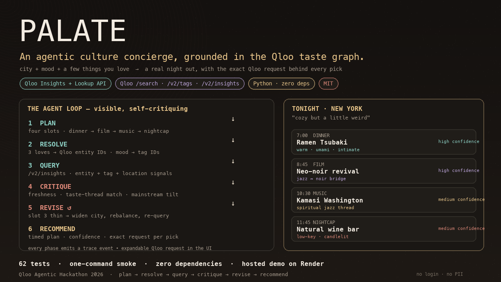
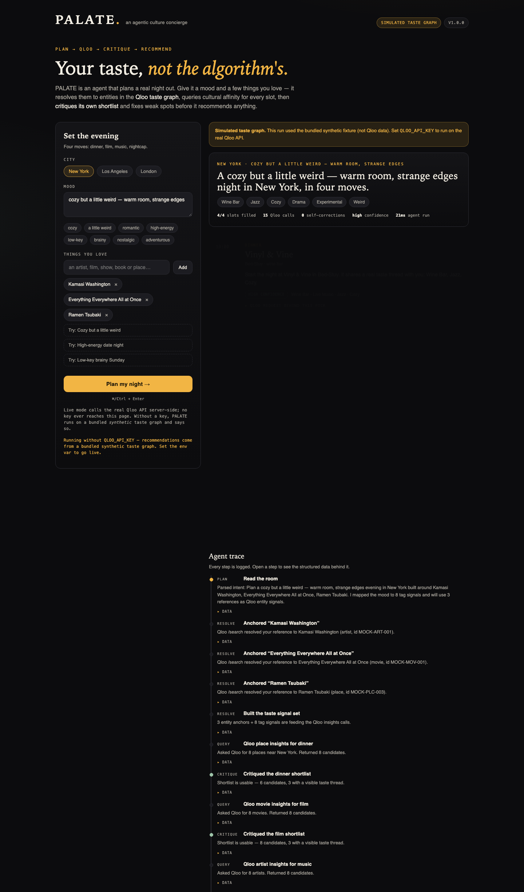

# PALATE — an agentic culture concierge, grounded in the Qloo taste graph

**PALATE plans a real night out from your taste — not from popularity lists.**
Give it a city, a mood, and a few things you love. It resolves those references to entities in the
[Qloo](https://qloo.com) taste graph, queries cultural affinity for every slot of the evening
(dinner → film → music → nightcap), **critiques its own shortlist**, re-queries with a revised signal
set when a slot is weak, and only then recommends — with a confidence badge and the exact Qloo
request behind every pick.

> An agent that knows *what people actually like*. Qloo supplies the cultural grounding; PALATE supplies
> the planning loop, the self-critique, and the product.

Built for the **Qloo Agentic Hackathon 2026** (Devpost). MIT licensed. Python standard library only —
zero dependencies, no build step.





---

## Devpost project summary

### Inspiration
Every AI agent can plan now. Almost none of them have taste. Assistants recommend the same five restaurants and the same three albums — competent, culturally blind. Taste isn't a prompt problem; it's a data problem: you need to know how audiences actually relate across music, film, food and place. So PALATE is built around the smallest, most human decision I could find — *what should I do tonight?* — a decision entirely about taste, where generic recommendations are immediately, personally wrong. Qloo supplies the cultural grounding; PALATE supplies the planning loop that uses it honestly.

### What it does
Give PALATE a city, a mood, and a few things you love. It resolves those references to entities in the Qloo taste graph, queries cultural affinity for every slot of the evening (dinner → film → music → nightcap), **critiques its own shortlist**, re-queries with a revised signal set when a slot is weak, and only then recommends — with a confidence badge, the taste threads connecting each pick to you, runner-up candidates, and the exact Qloo request behind every decision. The full agent trace is visible in the UI, so nothing is a black box. With `QLOO_API_KEY` set it talks to the real Qloo API (green badge); without a key it runs on a clearly-labelled synthetic taste graph (amber badge). A key never reaches the browser.

### How we built it
- **Agent loop** (`palate/agent.py`): explicit phases with structured trace events — plan, tool calls, critique, revise, recommend — no framework magic, all inspectable in the response JSON.
- **Qloo integration** (`palate/qloo.py`): one client interface, two implementations. `LiveQlooClient` uses `GET /search` (resolve references), `GET /v2/tags` (mood → real Qloo tag IDs) and `GET /v2/insights` (recommendations) against `https://hackathon.api.qloo.com`, authenticating with the `X-Api-Key` header and sending `filter.type`, `signal.interests.entities`, `signal.interests.tags`, `signal.location.query`, `take` and `feature.explainability` as documented. `MockQlooClient` serves the same three methods over a bundled synthetic taste graph (56 entities, 48 tags, hand-authored cross-domain taste bridges such as jazz ↔ noir) that is clearly labelled as not Qloo data.
- **Web app**: a dependency-free Python `http.server` serving a hand-built single-page vanilla JS/CSS UI, plus `POST /api/plan` and `GET /api/healthz`. Rate-limited, size-limited, no persistence, no accounts, no PII.
- **Honesty engineering**: responses carry their data source; a failed live call produces a labelled simulated fallback instead of a fake "live" result; every recommendation carries confidence and its Qloo query.
- **Tests + ops**: 62 stdlib `unittest` tests covering the agent loop, the exact live API contract (via an injected fake transport), the mock graph and the HTTP server; a one-command smoke test; a Dockerfile and a Render blueprint so the hosted demo deploys with no build step.

### Challenges
- **No API key during development** — Qloo hackathon keys are provisioned manually. Built mock and live as one interface so the agent only ever sees a client; the offline path exercises exactly the same code. Contract tests pin the live request shape; flipping one env var switches to the real API.
- **Docs sharp edges** — hackathon keys only work against `hackathon.api.qloo.com`; the key goes in `X-Api-Key`, not a Bearer header; `/v2/insights` is a GET with query parameters; unsupported parameters are silently ignored rather than erroring. Each is encoded as explicit behaviour and a test case.
- **Making a taste graph feel real offline** — random data produces nonsense; hand-authored cross-domain affinity bridges make jazz lead legitimately to a neo-noir film and a wine bar.
- **Designing for trust** — an agent that hides reasoning is just a recommender. Every phase emits a trace event, every pick carries confidence, matched threads and the request behind it, and simulated data is never labelled live.

### Accomplishments
- A genuinely agentic loop where critique and revise actually change the outcome: the agent re-queries Qloo when its own shortlist is weak.
- A complete, polished product — single-page UI with trace, expandable Qloo requests, confidence badges, taste threads — not a CLI proof of concept.
- 62 tests, a one-command smoke test, zero dependencies, and a deployable hosted demo on a free tier.
- Honest failure modes: labelled mock, labelled fallback, no way to mistake simulated data for the real API.
- The whole integration is legible to a judge: exact endpoint calls are in the UI and the response JSON.

### What we learned
- **Cultural intelligence is cross-domain.** The interesting recommendations came from moving between music, film, food and place through taste — exactly what Qloo's taste graph is for.
- **Self-critique is cheap and high-value for agents.** Concrete critique signals (candidate count, matched threads, mainstream tilt, seed echoing) caught weak slots a single-shot prompt would have shipped confidently.
- **The boring parts of agent products are trust, labelling and cost control:** what data produced this, how confident is it, what happens when the API fails.
- **Hackathon logistics are a dependency.** Manually provisioned keys mean integrations must be testable without them; a mock/live interface boundary is the difference between a blocked weekend and a shipping one.

### What's next
- Verify and tune the live Qloo path end-to-end with the hackathon key, surfacing explainability metadata directly in each card.
- More slots and formats: weekend escapes, group taste merging, cities beyond the three demo presets.
- Optional accounts to save a taste profile, server-side caching of Qloo responses (private, never committed).
- A "why not the obvious pick?" comparison against a popularity baseline, so the Qloo difference is visible in the product.
- Parallel slot queries with the same visible trace.

### Built with
`python` · `python-stdlib` · `javascript` · `html5` · `css3` · `qloo` · `qloo-api` · `taste-graph` · `agentic-ai` · `ai-agents` · `multi-step-reasoning` · `rest-api` · `zero-dependencies` · `render` · `docker` · `hugging-face-spaces`

## Why it's an agent (not a prompt wrapper)

PALATE runs an explicit, inspectable loop. Every phase is a real decision point, not a label:

1. **Plan** — parses the request into four concrete slots and maps the free-text mood onto Qloo tag signals.
2. **Resolve** — calls `GET /search` for each thing you love, choosing the best Qloo entity match, and
   `GET /v2/tags` to ground the mood in real tag IDs. Unresolvable references are logged and the agent adapts.
3. **Query** — calls `GET /v2/insights` per slot with `signal.interests.entities`, `signal.interests.tags`,
   `signal.location.query` (for places) and `feature.explainability=true`.
4. **Critique** — scores its own shortlist: are there enough fresh candidates? Do they share a traceable
   tag thread with the profile? Is the result mainstream- tilted? Too thin → it **revises**.
5. **Revise** — a self-correction step: widen the location, rebalance references, switch to mood-only
   signals, or loosen tag filters — then query Qloo again (up to 3 attempts per slot, best round wins).
6. **Recommend** — assembles a timed itinerary, prevents duplicate picks, attaches confidence, matched
   taste threads, runner-up candidates, and the exact Qloo request that produced each recommendation.

The whole trace is returned by the API and rendered in the UI, so a judge can see *why* each
recommendation exists. `GET /api/healthz` reports which data source is live.

**Architecture**

```
 browser (static/index.html, vanilla JS)
        │  POST /api/plan {city, mood, loves[]}
        ▼
 app.py  (http.server, ThreadingHTTPServer, rate-limited, no deps)
        │
        ▼
 palate/agent.py  ── plan → resolve → query → critique → revise ↺ → recommend
        │                         │
        │                         └── palate/qloo.py  (one interface, two clients)
        │                                ├── LiveQlooClient ── HTTPS ── hackathon.api.qloo.com
        │                                │      GET /search · GET /v2/tags · GET /v2/insights
        │                                │      header: X-Api-Key  (server-side only)
        │                                └── MockQlooClient ── palate/mock_graph.py
        │                                       synthetic taste graph + curated cross-domain
        │                                       "taste bridges" (not Qloo data, clearly labelled)
        ▼
 JSON: {mode, plan, needs, trace[], itinerary[], summary, meta}
```

The app code paths are identical in both modes: the agent only ever sees the client interface, so
mock mode is a genuine rehearsal of live mode rather than a mock-up.

---

## Quickstart

Requires Python 3.9+ (uses only the standard library). Verified on Python 3.9.6; the Docker image targets Python 3.12.

```bash
cd contest-entries/qloo

# 1) run the web app (mock mode: no API key needed, no network)
python3 app.py
#    → http://127.0.0.1:8000

# 2) or run the agent from the terminal
python3 -m palate.cli \
  --city "New York" \
  --mood "cozy but a little weird" \
  --love "Kamasi Washington" \
  --love "Everything Everywhere All at Once" \
  --love "Ramen Tsubaki"

# 3) prove everything works
bash scripts/smoke.sh
```

Sample output: [`docs/sample-terminal.txt`](docs/sample-terminal.txt) ·
full machine-readable run: [`docs/sample-run.json`](docs/sample-run.json).

---

## Mock mode vs real (live) mode

| | mock mode | live mode |
|---|---|---|
| Data source | bundled synthetic taste graph (`palate/data/taste_graph.json`) | the real Qloo API |
| API key needed | no | `QLOO_API_KEY` |
| Network needed | no | yes |
| UI badge / API `mode` | `mock` | `live` |
| Use | tests, local demo, video, offline development | hackathon judging demo |

Mode selection is explicit and logged:

- `PALATE_MODE=auto` (default) → **live** if `QLOO_API_KEY` is set, otherwise **mock**.
- `PALATE_MODE=mock` → always simulated, even if a key exists.
- `PALATE_MODE=live` → requires a key; the app **refuses to start** with a clear message if it is missing.
- If a live run produces **zero** Qloo results (bad network/key), the server falls back to a simulated run
  but labels it `mock-fallback`, shows the failure reason in a banner, and logs a `system` trace event.
  It never pretends simulated data is live.

### Flip to real mode

```bash
# One-time: request a hackathon API key (Google Form linked from the Qloo guide).
# https://docs.qloo.com/reference/qloo-llm-hackathon-developer-guide#getting-your-api-key
# Keys are provisioned manually — allow a few business days.

export QLOO_API_KEY="your-hackathon-key"
export QLOO_BASE_URL="https://hackathon.api.qloo.com"   # default; hackathon keys only work here
export PALATE_MODE="live"
python3 app.py
```

Verify with `curl -s http://127.0.0.1:8000/api/healthz` — it should report `"mode": "live"`.
Full instructions, including hosted deployment: [`RUNBOOK.md`](RUNBOOK.md).

---

## How the Qloo API requirement is satisfied

The official Devpost rules require a *"working software application that integrates the Qloo API and
that either (a) functions as an agentic tool, (b) is built using an agent framework, or (c) integrates the
Qloo API into an existing agent."* PALATE is (a): an agentic tool whose recommendations are produced by
real Qloo insight calls. The integration is the product, not a badge:

| Qloo endpoint | How PALATE uses it |
|---|---|
| `GET /search` | resolves each thing the user loves (artist / film / show / book / place) to a Qloo entity ID |
| `GET /v2/tags` | maps the free-text mood to real Qloo tag IDs before any insight query |
| `GET /v2/insights` | the ranking engine for all four slots; uses `filter.type`, `signal.interests.entities`, `signal.interests.tags`, `signal.location.query`, `take`, `feature.explainability=true` |

Contract details implemented from the **official hackathon developer guide** (fetched and quoted
2026-10-27, see [`RULES-NOTES.md`](RULES-NOTES.md)):

- Base URL for hackathon keys: `https://hackathon.api.qloo.com` (staging/production URLs return 401).
- Auth header: `X-Api-Key` — **not** `Authorization: Bearer`, **not** a query parameter.
- `/v2/insights` is a **GET**; parameters go in the query string.
- `filter.type` is required and must be a supported entity type (`urn:entity:place`, `urn:entity:movie`,
  `urn:entity:artist`, …). Legacy `/recs` and `/recommendations` are not used.
- If the API silently ignores an unsupported parameter it returns empty entities (not an error), so the
  client surfaces candidate counts in the trace and the critique step reacts to thin results.

The API key is used **only** server-side (inside `LiveQlooClient._get`), never returned to the browser,
never echoed in traces (`_redact` keeps only parameter metadata), and never committed. `.gitignore`
excludes `.env`. Request logs contain no query strings.

---

## Testing

```bash
python3 -m unittest discover -s tests -v   # 62 tests, ~0.6 s, no network
bash scripts/smoke.sh                      # tests + CLI run + HTTP server + live-mode guard
```

Coverage highlights:

- `tests/test_qloo_client.py` — asserts the exact live contract: hackathon base URL, `X-Api-Key` header,
  `filter.type` / `signal.interests.entities` / `signal.interests.tags` / `signal.location.query` /
  `feature.explainability` parameters, `results.entities` parsing, 401/403/429/400/non-JSON error mapping,
  and mode resolution. Uses an injected fake transport, so no network is touched.
- `tests/test_agent.py` — end-to-end agent runs, trace ordering, four filled slots, rationale presence,
  determinism, seed-echo prevention, duplicate prevention, revision loop (via a client that fails first),
  honest empty-result behaviour, JSON serialisability, input validation.
- `tests/test_mock_graph.py` — search resolution, tag lookup, entity-type and location filtering,
  bridge evidence, and determinism of the offline affinity model.
- `tests/test_server.py` — real HTTP server on an ephemeral port: page serving, health check, sample
  profiles, `/api/plan` end-to-end, 400s for bad input, 404s, path-traversal rejection, body-size limit.

---

## Repository layout

```
app.py                       # web server + JSON API (stdlib http.server)
palate/
  agent.py                   # plan → resolve → query → critique → revise → recommend
  qloo.py                    # LiveQlooClient + MockQlooClient + mode resolution
  mock_graph.py              # offline synthetic affinity engine over the fixture
  cli.py                     # terminal front end
  data/taste_graph.json      # synthetic fixture: 56 entities, 48 tags, curated taste bridges
static/index.html            # single-page UI (vanilla JS/CSS, no dependencies)
tests/                       # 62 stdlib unittest tests
scripts/smoke.sh             # one-command proof that everything works
scripts/demo.sh              # local demo runner
docs/                        # screenshot, sample run JSON, sample terminal output
render.yaml                  # Render free-tier blueprint
Dockerfile                   # Hugging Face Spaces (Docker) / any Docker host
.env.example                 # every configuration knob, documented
LICENSE                      # MIT
```

---

## Hosting (required by the rules) — short version

The official hackathon page requires a **live, externally published demo**:
*"Submissions that only run locally or rely on private access will not qualify."*
This repo is deployable as-is on free tiers with no build step:

- **Vercel Hobby**: The public demo is at https://palate-qloo-agent-demo.vercel.app/.
  `vercel.json` builds the Python API functions and static page. Without a Qloo key,
  the demo explicitly labels all recommendations as simulated.
- **Render** (recommended, ~8 min): New → Web Service → this repo → start command `python3 app.py` →
  add `QLOO_API_KEY` as a secret env var. `render.yaml` describes the same service.
- **Hugging Face Spaces** (~10 min): create a Docker Space and push this repo; the included `Dockerfile`
  listens on `$PORT` (7860 by default).
- Deploy in **mock mode first** (works immediately, before your key arrives), then add `QLOO_API_KEY`
  and restart — the UI badge flips from *Simulated taste graph* to *Live Qloo API*.

Step-by-step: [`RUNBOOK.md`](RUNBOOK.md). Everything the end user must do personally (request the key,
create accounts, deploy, submit) is listed with time estimates in
[`SUBMISSION.md`](SUBMISSION.md#part-3--exact-user-only-checklist).

---

## Honest limitations (also marked UNVERIFIED in `RULES-NOTES.md`)

- **Mock data is synthetic, not Qloo data.** Fictional venue names, real public titles, invented affinity
  weights. The UI says so in a banner on every simulated run. Qloo response data is never committed
  (the developer guide forbids storing it in a public repository; we do not cache or persist it).
- The live client's parsing of `GET /search` and `GET /v2/tags` is defensive because their sample response
  bodies are not shown verbatim in the public docs; `GET /v2/insights` follows the documented sample
  response (`success` → `results.entities[]`, fields `name`, `entity_id`, `subtype`, `tags`, `properties`).
- `feature.explainability` is documented as returning per-result influence metadata; PALATE consumes it
  when present but never depends on a specific shape.
- The live path has not been exercised against the real API from this environment (no hackathon key was
  available). The contract above is implemented from the official developer guide and covered by
  contract tests; the hosted live demo is the end-to-end proof.
- Qloo hackathon keys are provisioned manually and can take **a few business days** — request yours before
  building further.

---

## License

MIT — see [`LICENSE`](LICENSE). The code is original work created during the hackathon submission period.
The synthetic fixture is fictional/synthetic; real entity names are public cultural references and are
used descriptively.
